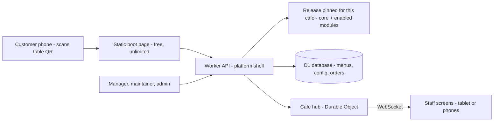

# DigiMenu TN

**Open-source QR menus and table ordering for small cafés and restaurants in Tunisia — in French, Arabic and English, light enough for 3G, and $0 per month to run.**

A project of **Why Not Solutions (WNS)** · Licence: [MIT](LICENSE) · Status: **foundation — MVP in progress**

---

## What it is

Customers scan the QR card on their table and the café's menu opens on their own phone, with the table already known. They browse in their language, build a list, and either send the order to the staff screen or show the list to the waiter. The café owner changes prices and marks items sold out from a phone, without a developer.

| For customers | For café staff and owners | For maintainers |
|---|---|---|
| Menu opens from the table QR in about 3 s on 3G | Orders arrive on the counter tablet or a waiter's phone, with a loud alert | Set up a new café from a template in under 2 hours, without code |
| French, Arabic (right-to-left) and English | Edit prices and availability from a phone, live within a minute | Switch features per café; switch a failing one off in minutes |
| Prices to the millime (4,500 DT) | Sales dashboard: orders through DigiMenu, best sellers, busy hours | Roll a café back to its previous version in under 15 minutes |
| No app to install; works on entry-level phones | Optional WhatsApp hand-off for takeaway | Print QR table cards from the café's table list |

**Every café runs the same code.** What differs is a set of switches and settings: optional features are **modules** that each café turns on or off. Each café is **pinned** to a tested release, and a new release reaches one pilot café before the others.

## Status

This repository is the **foundation**: folder structure, contracts (JSON schemas), architecture and decision records. Application code arrives sprint by sprint.

| Milestone | Target |
|---|---|
| v0.1.0 — demo café on a test address: menu, languages, list, show-to-waiter | end of Sprint 1 (late Oct 2026) |
| Real menus, staff screen, accounts and roles, checkout with consent | Sprint 2 (by 8 Nov 2026) |
| Go-live release candidate; printed table links frozen on 13 Nov | 20 Nov 2026 |
| Live at the pilot cafés in Monastir | 23 Nov – 4 Dec 2026 |
| v1.1 — loyalty and rewards; optional WhatsApp Business messages | Dec 2026 – Jan 2027 |
| Toolkit v1.0 with maintainer guides | by 3 Jan 2027 |

See the [changelog](CHANGELOG.md) for what has shipped.

## Architecture at a glance



- **Cloudflare free plan:** one Worker with static assets, one D1 (SQLite) database, one Durable Object per café for live orders. Table pages are static files, so menus stay up even if the daily request quota runs out.
- **Plain JavaScript** with JSDoc types checked by `tsc --checkJs`. No UI framework, no compile step: the files you write are the files that run.
- **Data apart from code:** deploying never changes a menu, a price, an order or a customer record.
- **Permanent table links:** `https://digimenu.wnsolutions.tn/<café>/t/<table>?k=<code>`.

Read more: [architecture overview](docs/architecture/overview.md) · [module system](docs/architecture/modules.md) · [data model](docs/architecture/data-model.md) · [releases](docs/architecture/releases.md) · [decision records](docs/adr/README.md)

## Repository map

| Folder | What lives there |
|---|---|
| [`platform/`](platform/README.md) | Shared runtime used by every café: [shell](platform/shell/README.md) (routing, sign-in, release dispatcher), [hub](platform/hub/README.md) (live orders, scheduled jobs), [admin](platform/admin/README.md) (staff screen, editor, dashboards), [migrations](platform/migrations/README.md) (database) |
| [`core/`](core/README.md) | The customer-side core of each release: menu, list, checkout, pricing, languages; [schemas](core/schemas/README.md) (contracts) and [i18n](core/i18n/README.md) (texts) |
| [`modules/`](modules/README.md) | Optional features, one folder per module, switched per café |
| [`cafes/`](cafes/README.md) | The fictional [demo café](cafes/demo/README.md), [test fixtures](cafes/_fixtures/README.md) and the [onboarding template](cafes/_template/README.md). **No real cafés here.** |
| [`tools/`](tools/README.md) | Command-line tools: [QR cards](tools/qr/README.md), [menu import](tools/import/README.md), [migrations](tools/migrate/README.md), [config validation](tools/validate/README.md), [release bundling](tools/release/README.md) |
| [`tests/`](tests/README.md) | Cross-cutting test suites: [contract](tests/contract/README.md), [snapshot](tests/snapshot/README.md), [end-to-end](tests/e2e/README.md), [budget](tests/budget/README.md), [accessibility](tests/a11y/README.md) |
| [`docs/`](docs/README.md) | Architecture, decision records, operations and product documentation |

## Quick start

> The application code is not here yet. These commands already work for the checks that exist, and grow with the MVP.

You need **Node.js 22** (the exact version is in `.nvmrc`) and Git.

```bash
git clone https://github.com/WNSolutions/digimenu-tn.git
cd digimenu-tn
npm ci          # install exactly the versions in package-lock.json
npm test        # run the tests
npm run check   # lint, formatting, type check and tests, as CI does
```

**Planned:** `wrangler dev` to run the whole system on your laptop with a local database and the demo café. Instructions will be in [operations](docs/operations/README.md) when it lands.

## How releases work

1. Every change goes through a pull request; automatic tests must pass and a second reviewer approves.
2. A tagged release is built once and added to the **release window** (at most 3 releases in one deployment).
3. **Ahmed, the project lead, approves every release** before it can reach a café. Nobody else can.
4. The release goes to **one pilot café first**, then to the others: one café per day for new features, the same day for small fixes.
5. A trained maintainer can put a café back on its previous release in **under 15 minutes**, or switch a failing feature off in under 10, but can never publish a release.

Details: [releases, pinning and rollback](docs/architecture/releases.md) · [ADR-0005](docs/adr/0005-release-window-pinning-and-approval.md)

## Contributing

Contributions are welcome. Read [CONTRIBUTING.md](CONTRIBUTING.md) first. For security issues, follow [SECURITY.md](SECURITY.md) and do not open a public issue.

Golden rules: same code for every café (no café-specific code); a feature for one partner is a module any café can switch on; no secrets, real café data or personal data in this repository.

## Licence

The code is released under the [MIT licence](LICENSE). The demo café and all sample data are fictional. Partner cafés' names, logos, photos and menus are **not** part of this repository and are not covered by the licence.

Real deployments keep their café content in a separate private repository; see [ADR-0003](docs/adr/0003-public-toolkit-and-private-deploy-repo.md).
