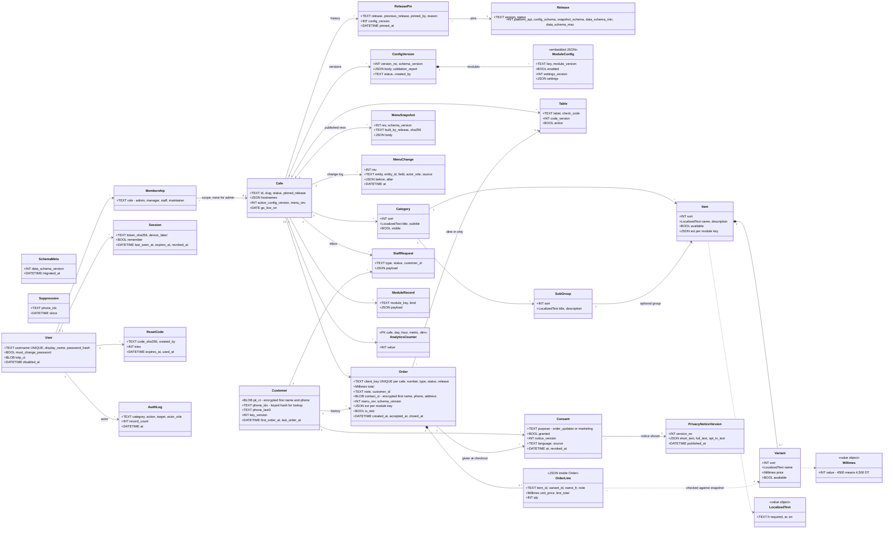

# Data model

> **Status:** current summary of the database design (Cloudflare D1, SQLite). The first migration file in [`platform/migrations/`](../../platform/migrations/README.md) will implement it.
> **Changed since v0.1:** accounts and roles follow D-026; customer records, consent and deletion follow D-027; the 30-day purge and `pii_purged_at` are removed. See [ADR-0006](../adr/0006-accounts-passwords-and-roles.md) and [ADR-0010](../adr/0010-customer-data-consent-and-deletion.md).

## Contents

- [Rules that apply to every table](#rules-that-apply-to-every-table)
- [Entities by area](#entities-by-area)
- [Diagram](#diagram)
- [Roles and what each one can reach](#roles-and-what-each-one-can-reach)
- [Customer data: consent, encryption, deletion](#customer-data-consent-encryption-deletion)
- [Retention](#retention)
- [Planned for v1.1](#planned-for-v11)

## Rules that apply to every table

| Rule | Detail |
|---|---|
| **Identifiers** | ULIDs (sortable, generated in code). |
| **Café scope** | Every café-scoped table has `cafe_id`. The data-access layer adds the café scope from the session or the URL to every query, so café A never sees café B. |
| **Money** | Integer **millimes** end to end: `4500` means 4,500 DT. The editor accepts "4,5" or "4.500" and stores 4500; a whole number of 100 or more typed without a comma ("4500") is always confirmed first ("4,500 DT or 4 500,000 DT?", D-045); it refuses more than 3 decimals. |
| **Translations** | `LocalizedText` is JSON `{"fr", "ar", "en"}` inside the row. French is required and is the fallback. Interface texts live in text files, not in the database. |
| **Variants** | Every item has at least one variant; a single-price item has one unnamed variant, so there is only one price path. |
| **Order lines** | Stored as JSON inside the order, with the name and unit price at the time of the order. Saves database writes. |
| **Schema versions** | `schema_meta.data_schema_version`, `config_versions.schema_version`, `menu_snapshots.schema_version`, `orders.schema_version`, module `settings_version`, and the list `v` on the phone. A release reads the current and the previous major format (MOD-11). |
| **Migrations** | Expand first (add tables or nullable columns), contract later (drop only when no release in the window uses the old field). Never rename or drop in one step. |
| **Personal data** | Only in the customer area and in encrypted order fields. Never in analytics, application logs, error reports, CI, fixtures or the public repository. |

## Entities by area

| Area | Table | Purpose |
|---|---|---|
| Platform and releases | `schema_meta` | Current database schema version. |
| | `releases` | Releases known to the deployment: version, status, `platform_api`, accepted data schema range. |
| | `cafes` | Slug, status, `pinned_release`, active configuration version, menu revision, go-live date, optional extra host names (not printed). |
| | `release_pins` | History of every pin change: from, to, who, why, configuration version. |
| Configuration | `config_versions` | Immutable published configurations; one is active per café. Holds the café configuration body ([schema](../../core/schemas/cafe-config.schema.json)) and the validation report. |
| | `tables` | Table label, check code, code version, active flag. Labels are never reused or renamed. |
| Menu | `categories`, `sub_groups`, `items`, `variants` | The menu tree. `items.ext` holds module fields under each module's key. |
| | `menu_snapshots` | Published menu revisions built by the café's pinned release (body, checksum, building release). |
| | `menu_changes` | Change history: entity, field, before, after, actor role, source (editor, import, undo, migration). Feeds undo and the autonomy indicator. |
| Orders and requests | `orders` | Client key (unique per café), number of the day, type, status, release, total, note for the whole order, lines (each with its own optional note; D-045, D-046), customer link, encrypted contact snapshot, `ext` per module, test flag, timestamps. |
| | `staff_requests` | Inbox items from modules (events, reservations, call waiter). |
| | `module_records` | Other module rows, namespaced by `module_key`. |
| Customers and consent (C-15) | `customers` | One record per phone number across all WNS cafés: encrypted first name and phone, keyed hash of the phone for lookup, last 3 digits for masked display. |
| | `consents` | One row per purpose and decision: order updates or marketing, granted or not, notice version, language, source, time, revocation. |
| | `privacy_notice_versions` | Short notice, full notice and opt-in wording in FR/AR/EN; every edit creates a new version. |
| | `suppressions` | Keyed hashes of phones that must never be messaged again (after opt-out or deletion). |
| Accounts and audit (C-14) | `users` | Username (unique across cafés), display name, password hash, "must change password" flag, encrypted authenticator secret, disabled time. |
| | `memberships` | Role per café: `manager`, `staff` or `maintainer`; `admin` has no café (all cafés). |
| | `sessions` | SHA-256 of the session token, device label, "remember" flag, last seen, expiry, revocation. |
| | `reset_codes` | One-time password reset codes, stored as SHA-256, single use, limited tries. |
| | `audit_log` | Append-only: account, configuration, release and customer-data actions (who, role, what, café, record count, time). |
| Analytics | `analytics_counters` | One counter per café, day, hour, metric and dimension (e.g. `t5\|ar`). No cookies, IP addresses or device ids. |

## Diagram

`Suppression` and `SchemaMeta` stand alone on purpose: a suppression entry must survive the deletion of the customer it came from.

## Roles and what each one can reach

Roles follow D-026. Permissions are checked on the server for every request; hiding a button is not security. The full permission table is in the [requirements](../product/README.md) (§2.1) and is tested pair by pair ([`tests/contract/`](../../tests/contract/README.md)).

| Data | Admin (Ahmed) | Manager | Staff | Maintainer |
|---|---|---|---|---|
| Menu, availability | all cafés | own café | availability only | assigned cafés (logged as maintainer) |
| Configuration, tables, QR cards | all | settings; view and print cards | — | assigned cafés; modules off at once, on with Admin approval |
| Orders on the staff screen | all | own café | own café | test orders only |
| Customer details on an order card | yes | first name; full phone and address only on open takeaway or delivery orders | same as Manager | no |
| Sales dashboard (orders through DigiMenu only) | all | own café | — | — |
| Visit analytics | all | own café | — | assigned cafés, no sales figures |
| Customer records, export, deletion, privacy notice | **Admin only** | — | — | — |
| Accounts | all | staff of own café | own password | own password |
| Release pins | publish and roll back | — | — | roll back only |
| Audit log | all, including customer-data access | own café's menu and account history | — | assigned cafés' menu and configuration history |

A Manager or Staff account belongs to one café. A Maintainer is assigned to one or more cafés. Admin has no café membership and covers all cafés.

## Customer data: consent, encryption, deletion

Decision D-027: WNS keeps customer data (first name, phone, order history) for every order, with recorded consent, export and deletion. Ahmed handles the legal requirements. Details and alternatives: [ADR-0010](../adr/0010-customer-data-consent-and-deletion.md).

- **At checkout:** first name and phone are asked for every order type (dine-in: per-café setting `dineInDetails`, default `required`). A short notice is shown above Confirm; the marketing box is unticked by default and never required. The order, the customer record and the consent records are written **together or not at all**.
- **One record per phone:** the same phone at any WNS café maps to one customer record, found through a keyed hash (`phone_idx`). Typing a phone number never reveals a stored name; pre-fill comes only from the phone's own browser.
- **Encryption:** first name, phone and address are encrypted field by field (AES-256-GCM) with a key held in Worker secrets, on top of Cloudflare's encryption at rest. Phones are decrypted only to show them to an allowed role, to send a WhatsApp message (v1.1) or to export.
- **Access:** only through core functions that check the role; every list, search, view, export, deletion and consent change is written to the append-only audit log.
- **Deletion on request:** after Admin checks the person controls the number and confirms twice: the customer record is deleted, contact fields on every order are blanked (orders stay as anonymous lines for counts and sales), loyalty balances are removed, and a suppression entry keeps the number from ever being messaged again. The deletion is logged without the phone number and cannot be undone.
- **Test orders** never create customer records. Preview and test databases never receive production personal data.

## Retention

| Data | Kept for | Notes |
|---|---|---|
| Customer records and their consents | until a deletion request, or the retention period Ahmed sets | Proposal: delete records with no order for 24 months (REQUIREMENTS Q24, open). |
| Orders | same as customer data for contact fields; anonymous lines as long as aggregates need them | Replaces v0.1's 30-day purge and 13-month roll-up. |
| Analytics counters | 24 months | Impact reporting needs at least 12 months. |
| Audit log | at least 24 months (assumption) | Append-only; readable by Admin. |
| Sessions, reset codes | until expiry, then pruned daily | — |
| Menu snapshots | recent revisions; older ones pruned daily | The change log stays. |
| Backups | rolling 8 weeks, encrypted | Deleted data disappears from backups when they expire. Backups are not committed to git history. |
| D1 Time Travel | 7 days | Cloudflare's built-in point-in-time restore. |

## Planned for v1.1

Not in the go-live release. Listed so the go-live schema does not block them.

| Table | Module | Purpose |
|---|---|---|
| `loyalty_ledger` | M-15 `loyalty` | Every earn, redeem and reversal, per café, linked to staff-confirmed orders. |
| `loyalty_rewards` | M-15 `loyalty` | Rewards defined per café by the manager. |
| `wa_accounts` | M-16 `whatsapp_business` | Café's WhatsApp Business connection; tokens encrypted, never sent to a browser. |
| outbox (café hub's own storage) | M-16 `whatsapp_business` | Messages to send, retries and statuses, kept off D1 to save quota. |

Related: [overview](overview.md) · [modules](modules.md) · [releases](releases.md)
