# Module system

> **Status:** current reference for the module contract (MOD-01 to MOD-18). Decision record: [ADR-0008](../adr/0008-module-system.md).
> **Contract file:** [`core/schemas/module.schema.json`](../../core/schemas/module.schema.json) (draft v0). Example: [`module.example.json`](../../core/schemas/examples/module.example.json).

Every café runs **the same code**. What differs between cafés is a set of switches and settings, never a copy of the code. Think of a phone: the core is the operating system, modules are apps each café installs, and café data (menus, orders) is stored apart so an update never touches it.

## Contents

- [Words we use](#words-we-use)
- [Folder layout of a module](#folder-layout-of-a-module)
- [The manifest](#the-manifest)
- [Extension points](#extension-points)
- [Off means zero bytes](#off-means-zero-bytes)
- [Isolation rules](#isolation-rules)
- [Per-café configuration and validation](#per-café-configuration-and-validation)
- [Who may switch a module](#who-may-switch-a-module)
- [Module catalogue](#module-catalogue)
- [Adding a module: checklist](#adding-a-module-checklist)

## Words we use

| Word | Meaning |
|---|---|
| **Core** | Features every café gets: menu, list, checkout pipeline, languages engine, pricing in millimes, café info, editor, analytics, QR cards. Lives in [`core/`](../../core/README.md) (customer side) and [`platform/`](../../platform/README.md) (shared runtime). |
| **Core component** | A core feature with a key so code, tests and logs can name it, but which **cannot be switched off**: `accounts_roles` (C-14), `customer_records` (C-15), `manager_dashboard` (C-16). |
| **Module** | An optional feature in `modules/<key>/`, switched on or off per café by configuration only (MOD-01). |
| **Extension point** | A named place where the core lets a module **add** something. Modules can only add; they never change the core or each other. |
| **Channel** | A module that submits an order: `send_order` (staff screen) or `whatsapp_handoff`. Each enabled order type has exactly one channel. |

## Folder layout of a module

```text
modules/<key>/
├── module.json            manifest: what the module is and needs (required)
├── client.js              contributions to the customer page (optional)
├── staff.js               contributions to the staff screen and admin app (optional)
├── server.js              server hooks (optional)
├── settings.schema.json   settings with safe defaults; also generates the admin form
├── settings.migrate.js    pure function to migrate settings (from settings version 2)
├── i18n/
│   ├── fr.json            texts; the three files have identical keys
│   ├── ar.json
│   └── en.json
├── tests/                 unit tests (node:test) and the module's fixtures
├── GUIDE.md               one page for maintainers: what it does, settings, how to switch off
└── CHANGELOG.md           module changes, newest first
```

The folder name **is** the module key. A module's code may import only the public core API (`@digimenu/core-api`), never another module and never core internals.

## The manifest

`module.json` is checked against [`module.schema.json`](../../core/schemas/module.schema.json) in CI (contract test, MOD-04). A release fails if any required item is missing.

| Field | Required | What it says |
|---|---|---|
| `key` | yes | Machine name, equal to the folder name; lowercase and underscores (`payment_choice`). Never renamed once released. |
| `id` | yes | Requirement ID, e.g. `M-04`. |
| `title`, `summary` | `title` yes | Names shown in the admin app, French required, Arabic and English recommended. |
| `version` | yes | Module semver. A MAJOR bump needs a settings migration. |
| `stability` | no | `experimental`, `stable` or `deprecated`. |
| `platformApi`, `coreApi` | yes | Platform generation and core API range the module needs; the deploy refuses a mismatch. |
| `requires`, `requiresAnyOf`, `conflicts` | no | Dependencies checked before publishing, e.g. `preorder` requires `order_types` with takeaway on. |
| `settings` | if any settings | Path of the settings schema, settings version, optional migration file. Defaults must be safe. |
| `texts` | yes | Paths of the FR, AR and EN text files (MOD-17). |
| `extends` | yes | Extension points used, grouped by file: `client`, `staff`, `server`, `shared`. |
| `data` | yes | What the module stores: `orderExt`, `itemExt`, `records`, and `personalFields` (first name, phone, address, free text). Empty lists mean nothing. |
| `customerRecords` | yes | `none`, `read` or `readWrite`, with a plain-language purpose when not `none` (MOD-04). |
| `externalService` | only for outside services | Provider, whether it is paid, `paidBy: "cafe"`, `failMode: "open"`, and the settings field that holds the daily cap (MOD-18). |
| `analyticsEvents` | no | Allow-listed event names; counts only. |
| `tests`, `guide`, `changelog` | yes | Paths of the tests folder, `GUIDE.md` and `CHANGELOG.md`. |

## Extension points

The core owns the URL scheme, pricing arithmetic, list storage, order lifecycle, sign-in and data access. Modules plug in only at the points below.

The full list is **named and reserved now** so names stay stable, but each point is **built with the first module that needs it** (Tech Lead review). "Go-live" marks the points needed by the modules planned for the 5 pilot cafés. A new point is added only in a core MINOR release, documented here, with a test fixture.

| # | Point | Side | A module may add | First needed by | Built for |
|---|---|---|---|---|---|
| 1 | `menu.itemBadge` | customer | label on an item or variant (icon + text, never colour only) | M-10, M-05, M-09 | Go-live |
| 2 | `menu.itemMedia` | customer | lazy thumbnail slot | M-08 | Go-live |
| 3 | `menu.itemDetail` | customer | block in the item detail sheet | M-08, M-10 | Go-live |
| 4 | `menu.section` | customer | section before or after the categories | M-14 (footer link), M-09, M-06 | Go-live |
| 5 | `menu.filter` | customer | filter chips on the category bar | M-10 | Later |
| 6 | `header.action` | customer | header button opening a module sheet or link | M-12, M-03, M-06, M-07 | Go-live |
| 7 | `table.action` | customer | button that needs a known table | M-13 | Later |
| 8 | `list.lineNote` | customer | warning on a list line | M-05 | Later |
| 9 | `list.action` | customer | action on the list screen | M-03 | Go-live |
| 10 | `checkout.fields` | customer | fields shown under conditions (type, table, hours) | M-01, M-04, M-05 | Go-live |
| 11 | `checkout.validators` | customer | client checks that mirror server rules | M-01, M-05 | Go-live |
| 12 | `checkout.channel` | customer | submit channel provider (one per order type) | M-02, M-03 | Go-live |
| 13 | `postOrder.block` | customer | block on the confirmation and status screen | M-02, M-14, M-11, M-15 | Go-live |
| 14 | `sheet.page` | customer | full-screen form opened by an action | M-06, M-07, M-11 | Later |
| 15 | `pricing.rules` | shared | **declarative** price rule applied by core pricing on phone and server alike | M-09 | Later |
| 16 | `staff.orderCardBlock` | staff | information on an order card | M-01, M-04, M-05, M-15 | Go-live |
| 17 | `staff.panel` | staff | panel or tab on the staff screen | M-06, M-07, M-13 | Later |
| 18 | `staff.requestType` | staff + server | new inbox entry type (schema, validation, card) | M-06, M-07, M-13 | Later |
| 19 | `admin.settings` | admin | settings form generated from the settings schema (no code) | all | Go-live |
| 20 | `admin.itemFields` | admin | extra per-item fields stored in `items.ext.<key>` | M-08, M-10, M-05 | Go-live |
| 21 | `admin.dashboardCard` | admin | declarative chart over the module's own events | M-06, M-11, M-15 | Later |
| 22 | `order.validate` | server | accept or refuse with a message key (**fail-closed**) | M-01, M-04, M-05 | Go-live |
| 23 | `order.enrich` | server | derived fields in `order.ext.<key>` | M-05 | Later |
| 24 | `order.afterStore` | server | side effects after commit (async, **fail-open**, isolated) | M-11, M-16 | Later |
| 25 | `order.statusChanged` | server | react to Accepted, Ready, Served/Collected, Rejected (async, **fail-open**) — **new since v0.1** | M-14, M-15, M-16 | Go-live |
| 26 | `analytics.events` | shared | allow-listed event names (manifest field `analyticsEvents`) | all | Go-live |
| 27 | `i18n.texts` | shared | FR/AR/EN texts in the module's namespace (manifest field `texts`) | all | Go-live |
| 28 | `schedule.daily` | server | upkeep of the module's own records | M-06, M-07, M-11 | Later |

The optional WhatsApp Business module (M-16) also needs an inbound webhook route outside `/api/*`. It will be designed with that module in v1.1, not as a general extension point.

## Off means zero bytes

A switched-off module leaves **no trace** for the customer: no screen, no field, no network request, no extra download (MOD-03).

- **Build.** The core and each module are separate entry points with content hashes (`/r/1.5.0/core.3f9a.js`, `/r/1.5.0/m/payment_choice.8c21.js`). Module CSS and texts become strings in the release manifest. Server hooks are bundled into the release's server module.
- **Boot.** `/api/boot` returns the file list for exactly the modules enabled in the café's active, validated configuration, with only their CSS and texts. The page imports those files and nothing else.
- **Server.** The hook registry is built from the enabled modules only. A disabled module's routes return 404 for that café.
- **Proof in CI.** "All modules off" is compared with "core only": same request list, page weight within 2 KB ([`tests/budget/`](../../tests/budget/README.md)).
- **Data is kept.** Switching a module off hides it; its stored data stays for when it is switched on again.

## Isolation rules

| Mechanism | What it enforces |
|---|---|
| Import boundaries (ESLint rule + CI import scan) | Modules import only `@digimenu/core-api`. The core never imports `modules/*`. No module imports another. |
| Scoped context `c` | A module sees only its own frozen settings, its own text namespace, its own storage prefix `dm:<café>:<key>:`, its own `ext.<key>` slice of items and orders, and its allow-listed events. |
| Namespaced data | `items.ext.<key>`, `orders.ext.<key>`, `module_records.module_key`. The data layer writes only the caller's namespace. |
| Customer records | Only through the permission-checked core API, only if the manifest declares it, and every access is logged (NFR-22). An undeclared access fails the contract test. |
| CSS scope | Class names prefixed `m-<key>-`; only core design tokens (CSS custom properties). |
| Failure isolation | Each contribution renders inside a guard: if it throws, it is skipped, a `module_error` event is counted, and the page carries on. A throwing `order.validate` refuses the order with the show-to-waiter fallback. A throwing `afterStore` or `statusChanged` is logged; the order stands. |
| Paid outside services | Off by default, switched on only by Admin with the café's written agreement, the café's own account and credentials (encrypted, never in config files or the repository), a per-café daily cap, and fail-open: orders never wait for them (MOD-18). |
| Tests | Removal test: delete a module folder and everything else still passes (MOD-02). Snapshot tests for the demo café and the all-on and all-off fixtures stay identical unless the changelog declares the change (MOD-06). |
| No café-specific code | A CI search for café slugs outside `cafes/` and data fails the build (MOD-15). A partner's need becomes a generic module any café can switch on. |

## Per-café configuration and validation

Each café's configuration follows [`cafe-config.schema.json`](../../core/schemas/cafe-config.schema.json) (draft v0). The demo café's [`info.json`](../../cafes/demo/info.json) is a complete example.

```json
{
  "ordering": {
    "types": {
      "dine_in": { "channel": "send_order" },
      "takeaway": { "channel": "whatsapp_handoff", "prepMinutes": 15 }
    },
    "dineInDetails": "required"
  },
  "modules": {
    "order_types": { "enabled": true },
    "send_order": { "enabled": true, "settings": { "ackAlertMinutes": 3 } },
    "whatsapp_handoff": { "enabled": true },
    "photos": { "enabled": false }
  }
}
```

**Order types are a core setting** (`ordering.types`), not a module setting as in v0.1: the core owns the checkout pipeline and the order lifecycle, and the validator must check one channel per type. The `order_types` module (M-01) still provides the type selector, per-type checkout fields and the takeaway time slot.

One validator package runs in four places: the admin app (instant feedback), the server (on publish), CI (every café's configuration against every release candidate) and the pin pre-flight ([`tools/validate/`](../../tools/validate/README.md)). Its steps:

1. The configuration matches the versioned JSON Schema.
2. Every enabled module exists in the café's pinned release, and its version is compatible.
3. Dependencies hold: `requires`, `requiresAnyOf`, `conflicts`. Every enabled order type names a channel that is enabled and provides `checkout.channel`. The default language is enabled. Messages name the missing piece, e.g. "preorder needs order_types with takeaway on".
4. Each module's settings match its settings schema; defaults are filled in.
5. Module `validateConfig` functions check business rules (e.g. "card" only if the café has a terminal).
6. Warnings: missing translations, no Google review link while `google_review` is on, dine-in on but tables without check codes.

Errors block publishing and **the last valid configuration stays live** (MOD-05). Warnings are shown but allowed. Each publish writes a new immutable configuration version (who, when, diff, report).

## Who may switch a module

| Action | Admin (Ahmed) | Manager | Staff | Maintainer |
|---|---|---|---|---|
| Switch a module **off** (kill switch, live in ≤ 10 min) | yes | asks Admin | pause orders only | **yes, at once**; Admin is notified (MOD-16) |
| Switch a module **on** at a live café | yes | asks Admin | no | prepares it; Admin approves (default until Ahmed answers otherwise) |
| Switch on a **paid** module (M-16) | yes, with the café's written agreement | no | no | no |
| Change module settings | yes | café settings only (e.g. Google review link) | no | prepares at setup |

All cafés start from the **standard template** (D-028): `order_types` with dine-in, `send_order`, `languages`, and `google_review` when the café has a Google review link. Every module is off by default in the code.

## Module catalogue

Priorities and dates come from the requirements ([product docs](../product/README.md)). "On request" means built after go-live only if a café asks.

| ID | Key | Module | Depends on | Planned |
|---|---|---|---|---|
| M-01 | `order_types` | Order types: dine-in, takeaway, delivery selector and fields | a channel; `customer_records` | Sprint 2 (dine-in); takeaway where chosen |
| M-02 | `send_order` | Send order to the staff screen (**standard channel**) | M-01, `accounts_roles` | Sprint 2 |
| M-03 | `whatsapp_handoff` | Store the order first, then open WhatsApp to the café with number and summary | `customer_records` | Sprint 1 (demo), Sprint 2 (stores order and consent) |
| M-04 | `payment_choice` | Cash or card at the counter, shown to staff | M-01 | Go-live where chosen |
| M-05 | `preorder` | Items ordered N hours ahead | M-01 (takeaway), a channel | On request |
| M-06 | `events` | Events and catering request form | a channel | On request |
| M-07 | `reservations` | Reservation request | a channel | On request |
| M-08 | `photos` | Item photos, small and lazy-loaded | — | Go-live where chosen |
| M-09 | `specials` | Daily specials and happy hour | — | On request |
| M-10 | `dietary_tags` | Allergen and dietary tags | — | Go-live where chosen |
| M-11 | `feedback` | Private 1–5 rating and comment | M-02 for the after-order prompt | On request |
| M-12 | `languages` | Which of FR/AR/EN a café shows, and the switch | — | Sprint 1 |
| M-13 | `call_waiter` | Call waiter or ask for the bill | M-02 | On request |
| M-14 | `google_review` | Same Google review invitation for every customer after Served | M-02 | Go-live where the café has a link |
| M-15 | `loyalty` | Points per staff-confirmed order, rewards set per café | `customer_records`, M-01, M-02 | v1.1 (after go-live) |
| M-16 | `whatsapp_business` | Automated WhatsApp messages via the official Business Platform, **paid by the café** | `customer_records`, M-02 | v1.1, only where a café opts in |

Youth certificates are **not** a module: see [ADR-0009](../adr/0009-certificates-outside-the-cafe-toolkit.md).

## Adding a module: checklist

1. Open a "module proposal" issue and get the Tech Lead's agreement on the key, the extension points and the quota cost (any new per-visit request must be justified).
2. Create `modules/<key>/` with the layout above; write `module.json` and check it against the schema.
3. Use only existing extension points. If a new one is needed, it goes into a core MINOR release first, with a fixture and an update to this page.
4. Write settings with safe defaults, FR/AR/EN texts with identical keys, tests, `GUIDE.md` and `CHANGELOG.md`.
5. Run the removal test and the snapshot tests; update the all-on fixture.
6. Declare personal fields and customer-record access honestly; undeclared access fails CI.
7. Add the module to the catalogue above and to the [changelog](../../CHANGELOG.md).

```mermaid
flowchart TB
  subgraph CLIENT["Browsers"]
    BOOT["Static boot page - same for all cafes, minimal renderer"]
    CP["Customer page - core UI of the pinned release"]
    SA["Staff screen and admin app"]
    SW["Service worker - offline cache"]
  end

  subgraph SHELL["Platform shell - shared by all cafes, rarely changes"]
    RT["Router and cafe resolver"]
    AU["Sign-in, roles, cafe scope"]
    RD["Release dispatcher - reads cafe pin"]
    CV["Config validator - schema, dependencies, settings"]
    DA["Data access layer"]
    CRA["Customer records API - permission-checked, logged"]
    AI["Visit counting - inside the boot call"]
    HUB["Cafe hub - Durable Object per cafe, WebSockets"]
    CRON["Scheduled jobs - aggregates, retention, quota check"]
  end

  subgraph REL["Release bundle vX.Y.Z - immutable, pinned per cafe"]
    CORE["Core - menu, list, checkout pipeline, i18n, pricing in millimes"]
    REG["Module registry - loads only enabled modules"]
    subgraph EP["Extension points"]
      EPC["Customer: item badge, media, detail, menu section, filter, header action, table action, list note, list action, checkout fields, validators, channel, post-order block, sheet page"]
      EPS["Staff and admin: order card block, staff panel, request type, settings form, item fields, dashboard card"]
      EPV["Server: order validate, enrich, after store, status changed, request types, daily task"]
      EPX["Shared: pricing rules, texts FR AR EN, analytics events"]
    end
    subgraph MODS["Modules - same code for every cafe"]
      M01["M-01 order_types"]
      M02["M-02 send_order"]
      M03["M-03 whatsapp_handoff"]
      MXX["M-04 to M-14 - payment, preorder, events, reservations, photos, specials, tags, feedback, languages, call waiter, google review"]
      MV11["M-15 loyalty, M-16 whatsapp_business - v1.1"]
    end
  end

  subgraph DATA["Data - separate from code"]
    D1M[("Menu tables and snapshots")]
    D1C[("Config versions and release pins")]
    D1O[("Orders, requests, module records")]
    D1P[("Customers, consents, privacy notice versions")]
    D1A[("Analytics counters")]
    D1U[("Users, sessions, audit log")]
    ASSETS[("Static assets - boot page and /r/version/")]
  end

  BOOT --> RT
  BOOT --> CP
  SA --> RT
  CP --> SW
  RT --> AU
  RT --> RD
  RD --> CORE
  CORE --> REG
  REG --> EP
  M01 -. contributes .-> EPC
  M02 -. contributes .-> EPC
  M02 -. contributes .-> EPS
  M02 -. contributes .-> EPV
  M03 -. contributes .-> EPC
  MXX -. contributes .-> EP
  MV11 -. contributes .-> EP
  MV11 -. declared access .-> CRA
  CV --> D1C
  RD --> D1C
  CORE --> DA
  DA --> D1M
  DA --> D1O
  CRA --> D1P
  AI --> D1A
  AU --> D1U
  CORE --> HUB
  HUB --> SA
  CRON --> DATA
  CP -. loads .-> ASSETS
```



Related: [overview](overview.md) · [data model](data-model.md) · [releases](releases.md) · [`modules/`](../../modules/README.md)
