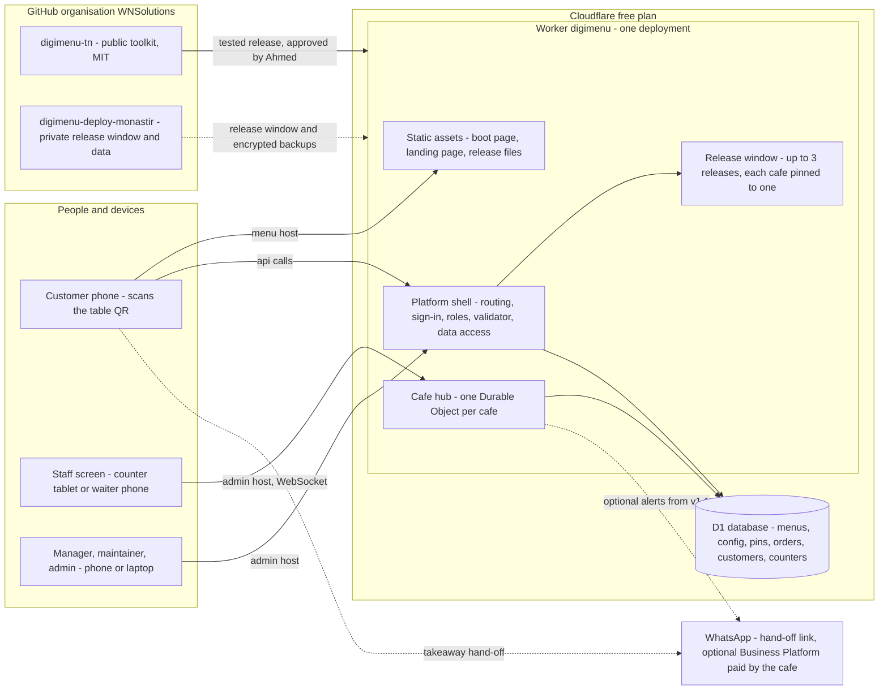
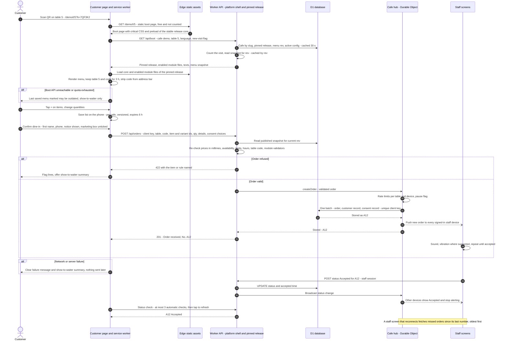
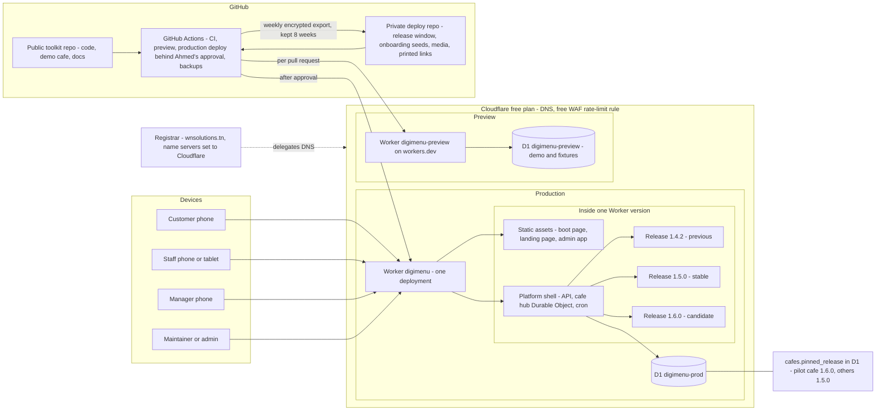

# Architecture overview

> **Status:** current reference, reconciled with the project decisions up to D-037 (21 Oct 2026).
> **Replaces:** the working draft "ARCHITECTURE v0.1" (10 Oct 2026). The section [What changed since v0.1](#what-changed-since-v01) lists every difference.
> **Owner:** Software Architect. Changes to this page go through a pull request, and lasting choices get an [ADR](../adr/README.md).

DigiMenu TN gives each partner café a QR-code menu that customers open on their own phone, sends orders to a staff screen, and lets each café switch optional features on or off. Everything runs on free plans: **$0 per month** for the project.

## Contents

- [Constraints that shape everything](#constraints-that-shape-everything)
- [System at a glance](#system-at-a-glance)
- [Components](#components)
- [Hosts and routes](#hosts-and-routes)
- [Main flows](#main-flows)
- [Data lives apart from code](#data-lives-apart-from-code)
- [Environments](#environments)
- [Security and privacy in brief](#security-and-privacy-in-brief)
- [Free-plan budget](#free-plan-budget)
- [What changed since v0.1](#what-changed-since-v01)
- [Checked in the spike](#checked-in-the-spike)

## Constraints that shape everything

| Constraint | What it means for the design |
|---|---|
| **$0/month** running cost | Cloudflare free plan and GitHub free only. Every daily quota keeps at least 10× headroom over the sizing load (5 cafés, 2,000 visits and 500 orders per day). No payment card on project accounts. |
| **Works on any phone, on 3G** | First visit ≤ 200 KB and ≤ 15 requests; menu usable in ≤ 3 s on typical 3G. No UI framework. |
| **French, Arabic, English** | All texts outside the code; Arabic laid out right-to-left; Western digits; prices in TND with 3 decimals. |
| **Maintained by trained youth** | Plain JavaScript, few dependencies, routine tasks done in the admin app without code, written guides. |
| **Safe change** | Same code for every café; features are modules switched per café; each café is pinned to a tested release; rollback in ≤ 15 minutes. |
| **Open source, private data** | Public MIT toolkit with a fictional demo café; real café content and all customer data stay private. |

## System at a glance

## Components

| Component | Where it runs | Folder | Responsibility |
|---|---|---|---|
| Boot page | static asset, same file for every café and table | [`platform/shell/`](../../platform/shell/README.md) | About 6 KB. Calls `/api/boot`, then loads the café's pinned release. A minimal renderer shows names and prices even if the release bundle fails. |
| Customer page | phone browser | [`core/`](../../core/README.md) + [`modules/`](../../modules/README.md) | Pinned release core (≤ 20 KB gzipped): category bar, list, checkout, language switch, show-to-waiter. Loads only the enabled modules' files. |
| Service worker | phone | `core/` | Cache-first for immutable release files; network-first with a 3 s timeout for menu data, falling back to the last copy marked "updated at …". |
| Platform shell | Worker `digimenu` | [`platform/shell/`](../../platform/shell/README.md) | Routing, café lookup, release dispatcher (reads the pin), sign-in and roles, config validator, data-access layer (café scope on every query), visit counting, café home page. Exposes the stable `platformApi` that releases call. |
| Release bundle | inside the deployment | built by [`tools/release/`](../../tools/release/README.md) | One immutable build per tag: core + modules (client files under `/r/<version>/`, server hooks), schemas, texts, menu renderer, snapshot builder. |
| Admin app | phone, tablet or laptop on the admin host | [`platform/admin/`](../../platform/admin/README.md) | Staff screen, menu editor, manager dashboard, maintainer screens (config, tables, QR cards, modules, rollback), Admin overview, customer records (Admin only). |
| Café hub | Durable Object, one per café, same Worker | [`platform/hub/`](../../platform/hub/README.md) | Numbers orders of the day, enforces idempotency, rate limits and the pause flag, pushes orders to every signed-in staff device over hibernating WebSockets. |
| Scheduled jobs | cron in the same Worker (≤ 3 of the 5 free triggers) | `platform/hub/` | Hourly: close analytics hour, quota check (alert at 70 %), unacknowledged-order watchdog. Daily: retention jobs, snapshot pruning. |
| D1 `digimenu-prod` | Cloudflare | [`platform/migrations/`](../../platform/migrations/README.md) | System of record for all café data. See [data model](data-model.md). |
| Tools | laptop or GitHub Actions | [`tools/`](../../tools/README.md) | QR card generator, menu import, migration runner, config validator, release bundler. |

## Hosts and routes

The domain comes from deployment configuration, never from code, so another city can deploy the toolkit on its own domain (or on a free `workers.dev` address). Values below are the WNS deployment's.

| Address | Served by | Cookies | Notes |
|---|---|---|---|
| `digimenu.wnsolutions.tn/` | static landing page | none | What DigiMenu is; link to the demo café. |
| `digimenu.wnsolutions.tn/<café>` | Worker: café home page, server-rendered and cached by menu revision | none | Short address printed under the QR. SEO and link previews. |
| `digimenu.wnsolutions.tn/<café>/t/<table>?k=<code>` | static boot page | none | **Permanent printed contract**, frozen Fri 13 Nov 2026. See [ADR-0004](../adr/0004-permanent-table-link-and-hosts.md). Not indexed. |
| `digimenu.wnsolutions.tn/r/<version>/…` | static, immutable, content-hashed | none | Release files; cached forever. |
| `digimenu.wnsolutions.tn/api/…` | Worker (platform shell) | none | Boot data, orders, status checks. Free WAF rate-limit rule applies. |
| `digimenu-admin.wnsolutions.tn` | admin app and admin API | host-only session cookie | Staff, managers, maintainers, Admin. Separate origin so a bug on a menu page cannot reach a session. |
| `wnsolutions.tn/verify/<id>` | **not DigiMenu** | — | Youth certificate verification, a separate WNS tool ([ADR-0009](../adr/0009-certificates-outside-the-cafe-toolkit.md)). |

Café slugs share the first path segment with platform routes, so words such as `api`, `r`, `t`, `admin` and `verify` are reserved. The full list is in [`cafe-config.schema.json`](../../core/schemas/cafe-config.schema.json).

## Main flows

1. **Customer opens the table link.** The static boot page arrives from the edge with no Worker call. It calls `GET /api/boot` with café, table, language and a new-visit flag. The shell reads the café's pin, menu revision and active configuration (cached 30 s), counts the visit in the same call, and returns the pinned release's file list, the enabled modules' texts and CSS, and the published menu snapshot. An unknown table still opens the menu, counted as "no table".
2. **Add to list.** Local only, saved on the phone per café (`dm:<café>:…`), versioned, expires after 6 h. Totals use integer millimes through the same pricing function as the server. Lines are re-checked against the current menu on every open.
3. **Check out.** The core checkout pipeline collects fields from modules, shows the short privacy notice and an unticked marketing box, and submits through the channel configured for that order type. With no channel, or when closed or paused, the customer gets the show-to-waiter screen.
4. **Order stored, staff alerted.** The phone sends ids and quantities only. The edge recomputes every price from the published snapshot and checks availability, limits, hours, the table code and module validators. The café hub applies rate limits, stores the order, customer record and consent record together (unique client key), and pushes the order to every signed-in staff device. The customer sees "No. A12" only after the database commit.
5. **Status.** Staff tap Accepted, Ready, Served/Collected or Rejected. Other staff devices update within seconds. The customer's page makes at most 3 automatic status checks, then shows "tap to refresh".
6. **Manager edits the menu.** Each save is validated, written atomically, logged in the change history, and produces a new menu snapshot built by the café's pinned release. Customers get it on their next load (target ≤ 1 min). Undo applies the inverse change as a new revision.

## Data lives apart from code

Deploying code never changes café data (MOD-10). Café data changes only through the app, the import tool or a declared migration.

| Data | Where | Changed by | Never changed by |
|---|---|---|---|
| Menus and published snapshots | D1 | manager, staff (availability), maintainer, import tool | code deploys |
| Café configuration (identity, languages, hours, ordering, modules and settings) | D1 `config_versions`, one active version | maintainer prepares, Admin approves "module on"; maintainer may switch a module off at once | code deploys |
| Tables and check codes | D1 | maintainer (QR generator) | code deploys |
| Release pins | D1 `cafes.pinned_release` + pin history | Admin (forward), maintainer (back only) | code deploys |
| Orders, customer records, consent records | D1 | café hub, shell, Admin (export, deletion) | code deploys |
| Analytics counters | D1 | visit counting, hourly job | code deploys |
| Logos and photos | private deploy repo `media/`, published as static files | media workflow (Planned, Sprint 3) | code deploys |
| Secrets | Cloudflare encrypted variables, GitHub Actions secrets | Admin | ever committed |
| Backups | weekly encrypted export, private, rolling 8 weeks; D1 Time Travel (7 days) | backup workflow | — |

## Environments

| Environment | Runs on | Data | Used for |
|---|---|---|---|
| Dev | laptop: `wrangler dev` with local D1 and local café hub | demo café + fixtures | building, unit tests |
| Preview | Worker `digimenu-preview` on `workers.dev`, deployed per pull request | demo café, fixtures, import files; **never production personal data** | review, end-to-end tests, owner previews |
| Production | Worker `digimenu` on the two hosts above; D1 `digimenu-prod` | live data | the partner cafés, each pinned to one release of the window |

Until the domain is active, the demo runs on `workers.dev` with the same path form, so nothing changes when the domain arrives.

## Security and privacy in brief

- **Prank orders:** every printed card carries a 6-character per-table check code (`?k=`, Crockford base32, revocable one card at a time). Dine-in sending requires it. Rate limits per table and per device, quantity and total limits, staff pause.
- **Floods and quota exhaustion:** table pages are static, so a flood costs no quota and menus stay up. The free WAF rule throttles `/api/*` per IP before the Worker runs.
- **Tampered prices:** the server recomputes every price from the published snapshot; client totals are ignored.
- **Script injection:** all customer text is shown as plain text; strict Content-Security-Policy; notes ≤ 200 characters.
- **Accounts:** username and password, roles checked on the server for every request, café scope checked in the data layer. See [ADR-0006](../adr/0006-accounts-passwords-and-roles.md).
- **Customer data:** collected with a notice and recorded consent, encrypted field by field, Admin-only access with an append-only access log, export and deletion on request. See [ADR-0010](../adr/0010-customer-data-consent-and-deletion.md).
- **Public code:** no secrets, café data or personal data in the public repository, CI logs or test fixtures (D-022). The full baseline is in [operations](../operations/README.md) and [SECURITY.md](../../SECURITY.md).

## Free-plan budget

Official figures from the Tech Lead review (10 Oct 2026), at the sizing load. The binding quota is Worker requests, so any new per-visit request must show its quota cost in review.

| Free quota per day | Expected use | Limit | Headroom | What keeps it low |
|---|---|---|---|---|
| Worker requests | ≈ 7,300 | 100,000 | ≈ 14× | static table pages and release files; WebSockets instead of polling; ≤ 3 customer status checks |
| D1 rows written | ≈ 8,000 (+ ≈ 500 for customer and consent records) | 100,000 | ≈ 12× | order lines stored as JSON in the order row; rate limits in café-hub memory; one counter upsert per visit; ≤ 2 secondary indexes on orders |
| D1 rows read | ≈ 150,000 | 5,000,000 | ≈ 33× | café and revision lookups cached 30 s; indexed queries only |
| Durable Object requests | ≈ 3,000 | 100,000 | ≈ 33× | hibernating WebSockets; outgoing pushes are free |

The optional WhatsApp Business module (v1.1) adds up to ≈ 2,400 Worker requests a day for webhooks; with its default `escalate` mode the total stays at about 10×. Quotas reset at 01:00 Tunis time. If one runs out, menus still open; only ordering and editing pause.

## What changed since v0.1

ARCHITECTURE v0.1 (10 Oct) was written before Ahmed's decisions of 14–21 Oct and the Tech Lead's review. Where they differ, this page and the ADRs win.

| Topic | v0.1 said | Now | Source |
|---|---|---|---|
| Printed table link | subdomain per café: `<café>.<domain>/t/<n>` | path form `digimenu.wnsolutions.tn/<café>/t/<table>?k=<code>`; café home at `/<café>`; landing page at `/`; reserved slugs | D-025, D-037, Tech Lead review |
| Staff/admin host | `admin.<domain>` | `digimenu-admin.wnsolutions.tn` (one-level host, covered by the free certificate) | REQUIREMENTS C-01, [ADR-0004](../adr/0004-permanent-table-link-and-hosts.md) |
| Sign-in | personal invite link per device, no passwords | username + password on any device, "remember this device", manager resets staff passwords, authenticator code for Admin | D-026, [ADR-0006](../adr/0006-accounts-passwords-and-roles.md) |
| Roles | owner, manager, staff, maintainer, admin | Admin, Manager (owner), Staff, Maintainer, with a server-enforced permission table | D-026 |
| Backup staff alerts | Telegram, optional per café | **no Telegram, no SMS**; optional WhatsApp Business Platform module (M-16, v1.1), paid by the café | D-023, D-030, [ADR-0007](../adr/0007-order-notifications-staff-screen-and-whatsapp.md) |
| Ordering channel | one submit channel per café | staff screen is the standard; one channel **per order type** (e.g. dine-in → staff screen, takeaway → staff screen or WhatsApp hand-off) | D-028 |
| Order types | inside the `order_types` module settings | core `ordering` section of the café configuration; the module keeps the type selector and fields | [modules](modules.md) |
| Personal data | dine-in asks nothing; personal fields blanked after 30 days | first name + phone on every order (dine-in: per-café setting), central customer records, consent records, versioned privacy notice, export and deletion; 30-day purge removed | D-027, [ADR-0010](../adr/0010-customer-data-consent-and-deletion.md) |
| Backups | weekly export without personal data | weekly export **with** personal data, encrypted twice (field level + whole file), private, rolling 8 weeks, kept out of git history | D-027, NFR-22 |
| Customer order status | status WebSocket, then polling every 20 s for 15 min | at most 3 automatic checks, then "tap to refresh" | Tech Lead review A4 |
| Release window | 3 releases | normally 2 (stable + candidate), 3 at most; patch releases may reach all cafés the same day after the pilot smoke check | Tech Lead review A7, [releases](releases.md) |
| Release approval | "Ahmed or delegate"; only Ahmed and the Tech Lead may run the production workflow | **Ahmed alone approves every release**; target: GitHub `production` environment with Ahmed as required reviewer (interim: allow-listed deploy workflow); maintainers may roll back but never publish | D-021, Tech Lead review A5 |
| Extension points | 27 points defined up front | full list named and reserved; each point is built with the first module that needs it; new server point `order.statusChanged` | Tech Lead review §3, REQUIREMENTS v0.2 |
| Order retention | order rows rolled into aggregates after 13 months | retention set by Ahmed (proposal: delete customer records with no order for 24 months); aggregates kept ≥ 12 months | D-027, REQUIREMENTS Q24 |
| Deferred items | media host + daily fallback menus, anonymised preview copy, full migration runner, 13 CI stages from day one | deferred to Sprint 3 or v1.0; until then service-worker copy, demo data on preview, SQL files + export + Time Travel, a minimal CI | Tech Lead review §3 |
| Certificates | — | youth certificates are a separate WNS tool, not a café module | D-032, [ADR-0009](../adr/0009-certificates-outside-the-cafe-toolkit.md) |

## Checked in the spike

These design assumptions were tested on a Worker on Cloudflare's free plan, 23 and 25 Oct 2026 ([spike note 0005](../spikes/0005-free-plan.md)).

| Assumption | Why it matters | Result |
|---|---|---|
| `/<café>/t/<table>` can be served as **one static file** without running the Worker | menus must keep working when the request quota runs out | **Confirmed**: `assets.not_found_handling = "single-page-application"` serves `index.html` to browsers; 0 Worker runs seen |
| PBKDF2 at ≈ 30,000–40,000 iterations fits p99 ≤ 7 ms of CPU | password sign-in within the 10 ms free CPU limit | **Failed**: only 20,000 fit (about 0.2 ms per 1,000 iterations) → browser-side stretching at 600,000 + server pepper, D-053 ([ADR-0006](../adr/0006-accounts-passwords-and-roles.md)) |
| Durable Object WebSocket hibernation on the free plan | staff screen without polling | **Confirmed**: two sockets kept, pushes delivered before and after hibernation |
| AES-GCM field encryption costs ≤ 50 µs per record | encrypted customer fields | **Confirmed**: about 8 µs per record |
| A 150-line menu renders at the edge within the 10 ms CPU limit | server render when needed | **Confirmed**: about 1–4 ms |

Related: [modules](modules.md) · [data model](data-model.md) · [releases](releases.md) · [ADR index](../adr/README.md) · [requirements](../product/README.md)
