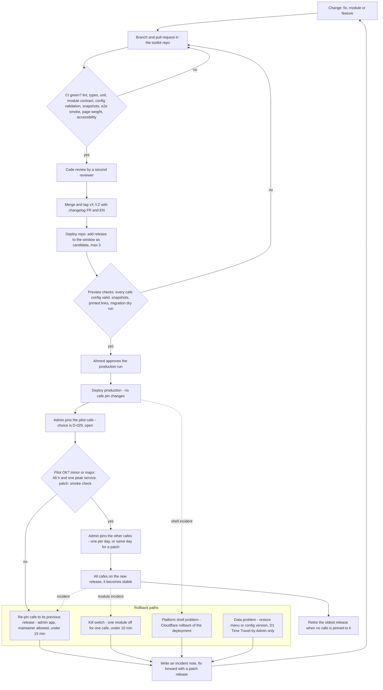

# Releases, pinning and rollback

> **Status:** current reference for MOD-07 to MOD-14. Decision records: [ADR-0005](../adr/0005-release-window-pinning-and-approval.md) (release window and approval) and [ADR-0004](../adr/0004-permanent-table-link-and-hosts.md) (permanent links).
> **Open decision:** D-029, which café receives each new version first, is due **Sun 22 Nov 2026**.

**In one paragraph.** Each tagged version of the toolkit is built once into an immutable release. One production deployment carries a small **window** of releases (at most 3). Each café is **pinned** to one release in the window, and the pin is a value in the database, so moving a café forward or back is a one-minute data change, not a new deploy. **Ahmed approves every release** before it can reach a café (D-021). A new release goes to one pilot café first, then to the others. A trained youth can put a café back on its previous release in under 15 minutes, but can never publish a new one.

## Contents

- [What carries a version](#what-carries-a-version)
- [The release window](#the-release-window)
- [Pins are data](#pins-are-data)
- [Who can do what](#who-can-do-what)
- [Rollout: pilot first](#rollout-pilot-first)
- [Rollback in 15 minutes](#rollback-in-15-minutes)
- [The permanent link contract](#the-permanent-link-contract)
- [Database migrations](#database-migrations)
- [Flow diagram](#flow-diagram)

## What carries a version

| Thing | Version | Rule |
|---|---|---|
| Toolkit release (core + modules) | git tag `vMAJOR.MINOR.PATCH` + changelog in French and English | MAJOR only for incompatible configuration or menu formats, or extension-point contracts. MINOR adds a module or a feature. PATCH fixes. Minor and patch releases never require changes to café data or configuration (MOD-07). |
| Module | semver in `module.json`; the release pins module versions | A module's MAJOR bump needs a settings migration. |
| Platform shell | `platformApi` integer + semver | Releases declare the `platformApi` they need; the deploy refuses a mismatch. |
| Database schema | migration number in `schema_meta` | Expand first, contract later. |
| Configuration, menu snapshot, order, list | `schemaVersion` or `v` field in each | A release reads the current and the previous major format (MOD-11). |

Planned milestones: **v0.1.0** at the end of Sprint 1 (demo café only), the go-live release candidate on **Fri 20 Nov 2026**, toolkit **v1.0** by **Sun 3 Jan 2027**.

## The release window

- **Size:** at most **3** releases (`previous`, `stable`, `candidate`). In normal operation the window holds **2** (stable + candidate); 3 is a ceiling for the time a rollback target is still needed.
- **Where it is declared:** `releases.json` in the private deploy repository. Its shape is [`release-window.schema.json`](../../core/schemas/release-window.schema.json); an [example](../../core/schemas/examples/release-window.example.json) shows a stable release and a pending candidate.
- **Adding a release changes no café.** Pins are untouched. A test asserts that every café's boot response and home page are byte-identical before and after the deploy.
- **Compatibility gate.** Every release in the window must accept the current database schema and `platformApi`, or the deploy is blocked.
- **Leaving the window.** A release is removed only when no café is pinned to it.
- **What is shared by all cafés.** The platform shell, the café hub and the database schema are not pinned per café. They are kept small, change rarely, and a shell rollback applies to every café at once.

## Pins are data

The pin lives in the database (`cafes.pinned_release`, with every change kept in `release_pins`). The shell sends each request to the pinned release's files and server hooks. Every café runs published code only (MOD-15), there is one deployable artifact, and each café moves on its own (MOD-08).

**Pin pre-flight (automatic, before every pin change):**

1. Validate the café's configuration against the target release.
2. If the configuration format differs, run the migration as a dry run and show the difference.
3. Create a new configuration version (the old one is kept).
4. Rebuild the menu snapshot with the target release.
5. Switch release, configuration version and snapshot in one atomic database batch.

## Who can do what

| Action | Admin (Ahmed) | Maintainer (trained youth) | Agents and other contributors |
|---|---|---|---|
| Approve and publish a release to production | **yes, only Ahmed** | no | no |
| Pin a café **forward** to a newer release | yes | no | no |
| Pin a café **back** to the release it ran before (still in the window) | yes | **yes** | no |
| Switch a module off for one café (kill switch) | yes | **yes** | no |
| Roll back the platform shell deployment | yes | with the written guide, if Ahmed asks | no |
| Restore data (D1 Time Travel) | **only Admin** | no | no |

**How the approval gate is enforced.** On GitHub's free plan, protected deployment environments with required reviewers are available only for public repositories. The **target** is therefore a production workflow in the **public toolkit repository**, inside a `production` environment whose **required reviewer is Ahmed**, so GitHub itself enforces the rule. **Today** the deploy workflow lives in the private deploy repository and only accounts on an allow-list (Ahmed) can run it. The Tech Lead confirms the final mechanism before the first production deploy ([ADR-0005](../adr/0005-release-window-pinning-and-approval.md)). Either way, contributors and agents cannot approve a deployment. The exact workflow is documented by DevOps in [operations](../operations/README.md).

## Rollout: pilot first

1. Tag the release in the toolkit repository; CI must be green (MOD-13).
2. Add it to the window in the deploy repository as `candidate`.
3. Preview checks: every café's configuration against the new release, café snapshot differences compared with the changelog, every printed link, migration dry run, end-to-end smoke test per café.
4. **Ahmed approves** the production run. The deploy changes no pin.
5. Admin pins the **pilot café** and watches it with a checklist: orders arrive, edits go live, no `module_error` counted.
6. Admin pins the other cafés.
7. The release becomes `stable`; the oldest release leaves the window when no café uses it.

| Release type | Pilot check | Other cafés |
|---|---|---|
| **Minor or major** | 48 hours including one peak service | one café per day |
| **Patch** | smoke check at the pilot café | the same day |

**Which café is the pilot** is decision D-029, still open (due Sun 22 Nov 2026). The earlier proposal is "the wave-1 café with the most engaged owner". Until D-029 is decided, no partner café is pinned to a candidate; candidates run on the demo café and on preview only.

**Go-live freeze.** From Fri 20 Nov to Fri 4 Dec 2026 only patch releases are published. Loyalty (M-15) and WhatsApp Business (M-16) are built on their own branch and ship as a minor release after the second go-live wave, pilot café first.

## Rollback in 15 minutes

| Situation | Action (written procedure) | Who | Time |
|---|---|---|---|
| A new release misbehaves at one café | Admin app → Café → Release → "Back to previous" (pre-flight in reverse; the previous configuration version is re-activated) | Maintainer or Admin | 2–5 min |
| One module is failing (e.g. orders) | Kill switch: module off → Publish. The café falls back to "show to waiter" | Maintainer or Admin | ≤ 10 min |
| A platform shell deploy breaks every café | Cloudflare dashboard → Worker `digimenu` → Deployments → previous version → Rollback. Table pages keep working meanwhile because they are static | Admin (a maintainer with the guide, if asked) | ≤ 5 min |
| Wrong menu change | Undo, or restore a menu revision | Manager, Maintainer | ≤ 1 min |
| Damaged data after a migration | Restore from the migration backup; D1 Time Travel (whole database, ≤ 7 days) as last resort | Admin only | ≤ 30 min (outside the 15-minute promise) |

Re-pinning never touches menus, configurations, orders or customer records, because they are data. The list saved on customers' phones migrates or is cleared silently. Durable Object class changes ship in their own additive deploy, because Cloudflare blocks a rollback across a class change. Both rollback paths are rehearsed and timed before go-live wave 1 and before v1.0 (MOD-09).

## The permanent link contract

Every printed QR card is permanent (MOD-14). The printed form is frozen on **Fri 13 Nov 2026**:

```text
https://digimenu.wnsolutions.tn/<café>/t/<table>?k=<code>
```

- The routes `/<café>` and `/<café>/t/*` belong to the platform shell; no release can remove or change them.
- Table labels are never reused or renamed. A retired table still opens the menu ("no table"). A revoked check code still opens the menu but cannot send dine-in orders.
- The QR generator appends every printed link to `printed-links.csv` in the private deploy repository. Every deploy opens all of them on preview and checks café and table.
- The domain is a single point of failure for every printed card: it must be renewed on time (multi-year purchase where allowed, a named renewal owner).

Details and reasons: [ADR-0004](../adr/0004-permanent-table-link-and-hosts.md).

## Database migrations

- Numbered SQL files in [`platform/migrations/`](../../platform/migrations/README.md), run only by the migration tool, **never** by a code deploy.
- **Expand, then contract.** First add tables or nullable or defaulted columns; never rename or drop. Then the releases in the window move to the new fields. Only when no release in the window uses the old field is it dropped (at least one MAJOR later).
- **Until v1.0:** SQL file + database export before applying + D1 Time Travel. **From v1.0:** the [`tools/migrate/`](../../tools/migrate/README.md) runner with `plan`, `backup`, `apply`, `verify` and `undo`.
- JSON formats (configuration, module settings, snapshot, list) migrate with pure `migrate(from, to)` functions, tested forward and back: no row lost, every price equal to the millime, every consent record intact.
- Orders keep the `schema_version` and `release` they were created with.

## Flow diagram



Related: [overview](overview.md) · [modules](modules.md) · [data model](data-model.md) · [changelog](../../CHANGELOG.md)
