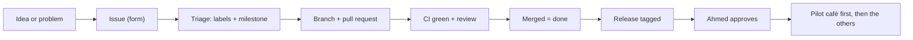

# Product docs

How DigiMenu work is described, planned and tracked. Start here if you want to know **what** we build, **when**, and **when a change is finished**.

| Page                                        | Answers                                                                 |
| ------------------------------------------- | ----------------------------------------------------------------------- |
| [Roadmap](roadmap.md)                       | What ships in each sprint, and the key dates                            |
| [Requirements index](requirements-index.md) | Which requirement (US-, C-, M-, MOD-, NFR-) is built in which milestone |
| [Labels](labels.md)                         | What each GitHub label means, and how new issues are triaged            |
| [Definition of done](definition-of-done.md) | When a code change is finished, and how it then reaches a café          |

## How work flows

1. **Issue.** Every piece of work starts as an issue, created with a form: bug report, feature request (user story), engineering task or module proposal.
2. **Triage.** A maintainer adds labels and a milestone ([labels](labels.md)).
3. **Build.** Branch, commits and pull request as described in [CONTRIBUTING.md](../../CONTRIBUTING.md).
4. **Done.** CI is green, the [definition of done](definition-of-done.md) is met, and the pull request is merged.
5. **Released.** A release reaches a café only after Ahmed approves it, pilot café first.

## Where other things live

| Topic                                | Where                                                                                  |
| ------------------------------------ | -------------------------------------------------------------------------------------- |
| Architecture and the module contract | [docs/architecture/](../architecture/) ([module contract](../architecture/modules.md)) |
| Decisions on design (ADRs)           | [docs/adr/](../adr/)                                                                   |
| Branching, versions and releases     | [docs/operations/branching-and-releases.md](../operations/branching-and-releases.md)   |
| Security reports                     | [SECURITY.md](../../SECURITY.md)                                                       |
| Changes in each release              | [CHANGELOG.md](../../CHANGELOG.md)                                                     |

## Where IDs come from

Requirement IDs (`US-01`, `M-04`, `NFR-12` ...) come from the project's requirements document (v0.2, 14 October 2026, with the certificates addendum of 17 October). Decision IDs (`D-021` ...) come from the project's decision log. Both are kept by the project team; this folder carries the IDs so every issue and pull request can be traced back to them. Real café names never appear in this public repository.
