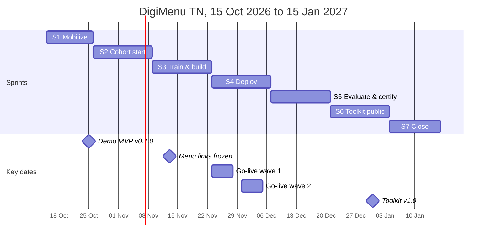

# Roadmap

> **Status:** plan as of 21 Oct 2026 · **Owner:** Product Analyst · Scope changes are approved by Ahmed (project lead).
> All dates are Tunis time. Each sprint is a GitHub milestone with the same name.

DigiMenu goes from a demo café to five live pilot cafés in about six weeks, then becomes a public toolkit that anyone can deploy.

## Milestones by sprint

| Milestone                 | Dates        | Goal                      | What ships                                                                                                                                                                                                                                                                                                       |
| ------------------------- | ------------ | ------------------------- | ---------------------------------------------------------------------------------------------------------------------------------------------------------------------------------------------------------------------------------------------------------------------------------------------------------------- |
| **S1 Mobilize**           | 15–25 Oct    | Demo MVP                  | **v0.1.0 on the demo café:** table link, menu with variants and prices, FR/AR/EN with right-to-left Arabic, My list and show-to-waiter, sign-in, price and sold-out editing, module registry and validator, visit counter, QR card prototype, CI with page-weight and smoke tests.                               |
| **S2 Cohort start**       | 26 Oct–8 Nov | Real menus in preview     | Orders reach the staff screen; staff screen on phones and tablets; accounts, roles and password resets; checkout with privacy notice and consent; full menu editor with history; module switches and kill switch; check codes. Real menus in preview for café managers (private repository). Certificate design. |
| **S3 Train & build**      | 9–22 Nov     | Go-live release candidate | Menu links frozen; QR cards printed; Admin customer area with export and deletion; release pins and rehearsed rollback; Google review invitation; dashboards and impact export; optional go-live modules; workshop-ready demo café and youth guide; certificate tools.                                           |
| **S4 Deploy**             | 23 Nov–6 Dec | All pilot cafés live      | Wave 1 (2 cafés), then wave 2 (3 cafés). Patch releases only. First certificates and the LinkedIn guide.                                                                                                                                                                                                         |
| **S5 Evaluate & certify** | 7–20 Dec     | Stable, measured          | Mid-project evaluation with visit and sales data. After-go-live features (loyalty) built on their own branch, pilot café first. Completion certificates.                                                                                                                                                         |
| **S6 Toolkit public**     | 21 Dec–3 Jan | Toolkit v1.0              | **v1.0 public release on Thu 31 Dec:** repository checked for private data, FR/EN guides, a guide for every module, new-café template.                                                                                                                                                                           |
| **S7 Close**              | 4–15 Jan     | Handover                  | Final data export; loyalty on all cafés by mid-January; handover to café owners and youth maintainers.                                                                                                                                                                                                           |

The detailed backlog is in GitHub issues, grouped by milestone. Which requirement lands in which milestone: [requirements index](requirements-index.md).

## Key dates

| Date                         | What happens                                                                                  | Depends on                                      |
| ---------------------------- | --------------------------------------------------------------------------------------------- | ----------------------------------------------- |
| Fri 23 Oct                   | Ahmed signs in to the demo with username and password                                         | Sign-in (US-36)                                 |
| Sun 25 Oct                   | **Ahmed approves v0.1.0, the demo MVP**                                                       | Everything in S1                                |
| Sun 1 Nov (latest Fri 6 Nov) | Domain `digimenu.wnsolutions.tn` active on Cloudflare                                         | Domain purchase                                 |
| Sun 8 Nov                    | Real menus in preview, links sent to café managers                                            | Menu import, editor                             |
| **Fri 13 Nov**               | **Menu links frozen** (`digimenu.wnsolutions.tn/<café>/t/<table>`); privacy notice text final | Real domain, check codes (US-16, MOD-14)        |
| 16–20 Nov                    | Final menu approval by owners; QR cards printed                                               | Frozen links, QR generator (US-32)              |
| Fri 20 Nov                   | Go-live release candidate; go-live gates checked. Patch releases only until 4 Dec             | S3 scope                                        |
| **Sat 21 Nov**               | **Youth workshop A**: demo café, staff screen, QR card generator                              | Workshop-ready demo café                        |
| Sun 22 Nov                   | Decision on the pilot café that receives each new release first (D-029)                       | Ahmed                                           |
| **23–27 Nov**                | **Go-live wave 1** (2 cafés)                                                                  | Release pinning, rollback rehearsal             |
| Thu 26 Nov                   | Certificate tools ready (register, PDFs, verification page)                                   | WO-043 to WO-046                                |
| **Sat 28 Nov**               | **Youth workshop B**; **first Participation certificates** (group A)                          | Verification page live                          |
| **30 Nov–4 Dec**             | **Go-live wave 2** (3 cafés)                                                                  | Lessons from wave 1                             |
| Sat 5 Dec                    | Participation certificates (group B)                                                          | Certificate tools                               |
| 7–13 Dec                     | Mid-project evaluation                                                                        | Visit dashboard, impact export, sales dashboard |
| Sun 20 Dec                   | Completion certificates                                                                       | Practice shifts confirmed                       |
| **Thu 31 Dec**               | **Toolkit v1.0 public release**                                                               | New-café template, guides, clean repository     |
| 4–8 Jan                      | Final data collection                                                                         | Impact export (US-31)                           |
| Fri 15 Jan                   | Project closes                                                                                | Handover                                        |

## Releases

| Release                | When                 | Who uses it                                                   |
| ---------------------- | -------------------- | ------------------------------------------------------------- |
| v0.1.0 · demo MVP      | Sun 25 Oct           | Demo café only, on a preview address                          |
| Preview releases       | S2 and S3            | Real menus in preview for managers; no live café yet          |
| Go-live release        | Candidate Fri 20 Nov | Pilot cafés, pilot café first, after Ahmed's approval         |
| Patch releases         | 20 Nov–4 Dec         | Fixes only, during the go-live waves                          |
| After-go-live features | From December        | Loyalty first; optional WhatsApp Business when a café opts in |
| v1.0 · public toolkit  | Thu 31 Dec           | Anyone who wants to deploy DigiMenu for their own city        |

In the requirements, "v1.1" is the name of a **scope** (features built after go-live), not a version number. Version numbers follow Semantic Versioning ([CHANGELOG.md](../../CHANGELOG.md)) and the rules in [branching and releases](../operations/branching-and-releases.md). No release reaches a café before Ahmed approves it in writing (decision D-021).

## Go-live gates

These protect the 4 December go-live. They are checked for each café in the private deploy repository.

1. **No real customer data** before the privacy checks pass: role tests, details and consent at checkout, customer records with access log, export and deletion, privacy notice approved in FR/AR/EN, encrypted backup with a tested restore, and the legal check. Until then, the café goes live with the menu and show-to-waiter only.
2. **Ordering is switched on at a café only after the staff screen has been checked on that café's own devices.**
3. **No after-go-live code in the go-live release.** Loyalty and WhatsApp Business are built on their own branch after 20 Nov. From 20 Nov to 4 Dec, only patch releases.
4. **If S3 runs late, the manager sales dashboard moves first** (patch during wave 2, or later). It does not affect customers.

## Not planned for go-live

Online payment, customer accounts with passwords, SMS, Telegram, till or printer integration, stock management, native apps, and automatic translation without human review. Search, delivery, pre-orders, events, reservations, daily specials, private feedback and call-waiter are built after go-live only if a café asks for them.

## How this roadmap changes

The roadmap is reviewed at the end of every sprint. Moving a Must item out of its milestone needs Ahmed's OK; the change is noted in the pull request that updates this page.
